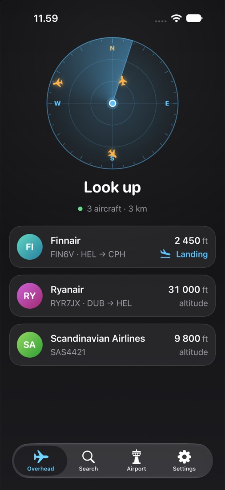
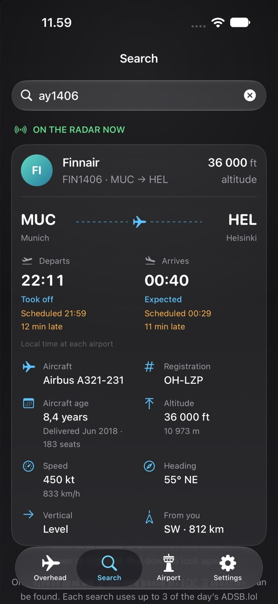
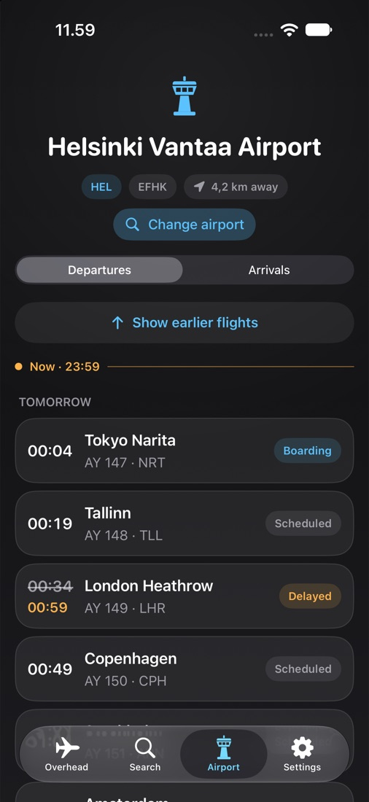
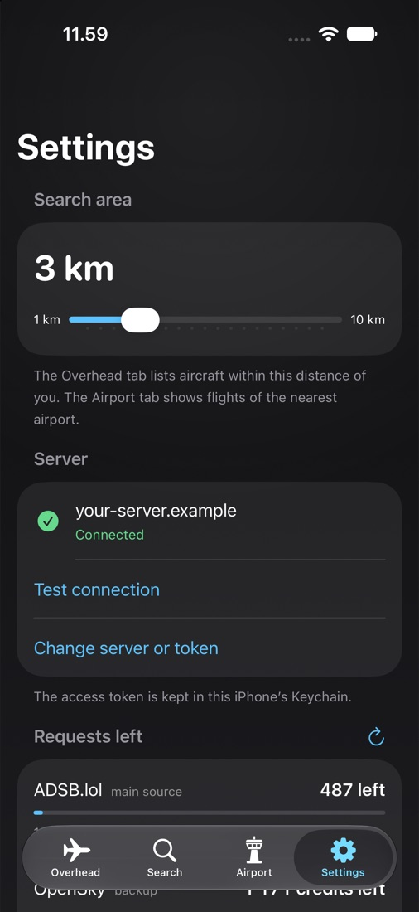

# ScanUp

An iPhone app for looking up at the sky. Open it and it tells you which aircraft are above you, finds one plane by its flight number, and shows what is leaving and arriving at an airport.

It is a personal project. It needs a small backend of your own (see [How it works](#how-it-works)); there is no public server.

<p align="center">
  
  
  
  
</p>

The screenshots use made-up data.

## What it does

- **Overhead.** The aircraft within a distance you choose (3 km by default, up to 10 km), on a radar that turns with the compass. Tap one for its route, type, registration, age, altitude, speed and where in the sky to look. Planes that are landing or taking off say so.
- **Search.** Type a flight number (`AY1406`), a callsign (`FIN5DA`) or a registration (`OH-LXF`). If that plane is in the air and heard right now you see where it is, how high and fast, its route, and when it left and is due. If it is not flying you are told what became of it: landed, cancelled, or not left yet.
- **Airport.** Departures and arrivals of the nearest airport, or of any airport you search for. It opens at "now" with the next 15 flights, and "Show earlier flights" and "Show later flights" add 30 more each time, from 12 hours back to about 11 hours ahead. Times are on the airport's own clock, with delays and status.
- **Settings.** The server address and token, the search distance, what is left of each data source's allowance, and a fake location for trying the app without moving.

## How it works

The app does not talk to any aircraft or schedule service itself. It talks to **your own backend**, which does, and keeps the keys. The app only holds the backend's address and an access token, in the iPhone's Keychain.

```
iPhone app  ──HTTPS + token──▶  your backend  ──▶  ADSB.lol, OpenSky (aircraft)
                                                ├─▶  adsbdb (airline, route, type)
                                                ├─▶  AeroDataBox (schedules, aircraft age)
                                                └─▶  AirLabs, FlightAware (boards, when AeroDataBox cannot answer)
```

- **Position.** Read only while the app is open and sent only to your backend. Nothing runs in the background, and the app keeps no account or history.
- **The API.** [docs/api.md](docs/api.md) describes the requests the app makes, so you can write a backend for it in any language. The author's backend is a private project and is not included.
- **Pace.** The backend tells the app how often to refresh, and the app stops when nobody is using it, so it spends few of the free services' requests.

## Build

You need Xcode with the iOS 27 SDK (the project uses Swift 6 with default main-actor isolation) and an iPhone, or the simulator.

1. Open `ScanUp.xcodeproj`.
2. Select the `MyApp` target, **Signing & Capabilities**, and choose your own team. The bundle identifier and team in the project are the author's; change both.
3. Run on a device or simulator.
4. In **Settings**, enter your backend's address (HTTPS, no path) and access token, then **Test connection**.

The simulator has no compass; the radar then keeps north up. In Settings, **Use a fake location** picks a fixed place (the airport, or central Helsinki) so you can try the app without being near one.

## Checks

```sh
scripts/logic-checks/run.sh
```

Compiles the pure logic (angles, drift, location errors, the backend's answers, board rows and paging, search text) and checks it. It needs only the Swift toolchain, no Xcode project, simulator or network.

## Layout

| File | What it holds |
|---|---|
| `FlightStore.swift` | State of the screens, refresh pacing, back-off, idle pause |
| `BackendClient.swift` | The backend connection, token storage and request code |
| `LocationFetcher.swift`, `LocationFailure.swift`, `TestLocation.swift` | Position, compass and the fake location |
| `Compass.swift` | Angle maths for the radar |
| `Aircraft.swift`, `Schedule.swift`, `Usage.swift` | What the backend sends: aircraft, boards, flights, allowances |
| `RootView.swift`, `OverheadView.swift`, `SearchView.swift`, `AirportView.swift`, `SettingsView.swift` | The screens |
| `AircraftCard.swift`, `FlightViews.swift`, `RadarView.swift`, `FeedViews.swift`, `Theme.swift` | Components |

All under `MyApp/`.

## Things to know

- A closure that a system framework calls on another thread must be marked `@Sendable`, or the app is stopped by the system. This happened once in `Theme.swift`.
- iPhone is locked to portrait, because the compass reference is portrait.
- The branch `backup/before-schedules` and the tag `before-schedules` hold the app as it was before airport boards and search. [docs/switching-versions.md](docs/switching-versions.md) says how to switch between versions.
- [docs/public-release.md](docs/public-release.md) lists what an App Store release would need: mainly a data source whose terms allow it.

## Data and credits

- Aircraft positions: [ADSB.lol](https://adsb.lol) (open data) and [OpenSky Network](https://opensky-network.org) as a fallback.
- Airline, route and aircraft type: [adsbdb](https://www.adsbdb.com).
- Flight schedules and aircraft age: [AeroDataBox](https://aerodatabox.com), through RapidAPI. The free plan is for personal use only and requires crediting AeroDataBox, which the app does in Settings and under the boards and search results.
- Airport boards when AeroDataBox cannot answer (its monthly units are used up, or it is down): [AirLabs](https://airlabs.co) and [FlightAware AeroAPI](https://www.flightaware.com/aeroapi/), on their personal plans. The app credits the sources that supplied the flights on screen.
- Airports: [OurAirports](https://ourairports.com/data/) (public domain), held by the backend.

These services are free or community run and can change or stop. Do not rely on this app for anything safety-critical: positions and times can be late, wrong or missing.

## License

The code is released under the [MIT License](LICENSE). The flight data it shows comes from third-party services (see Data and credits above), each with its own terms, which the license does not cover.
